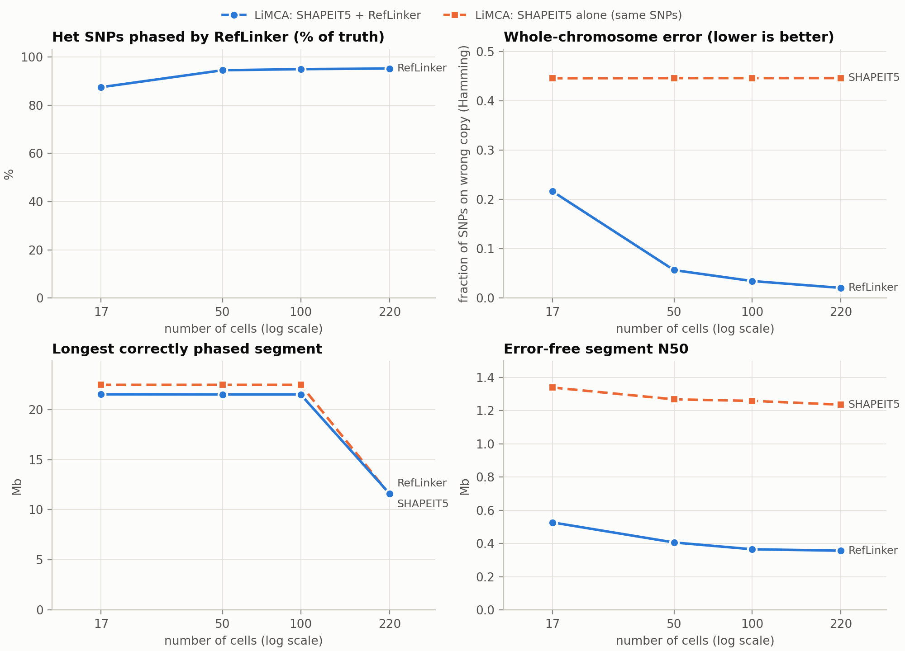
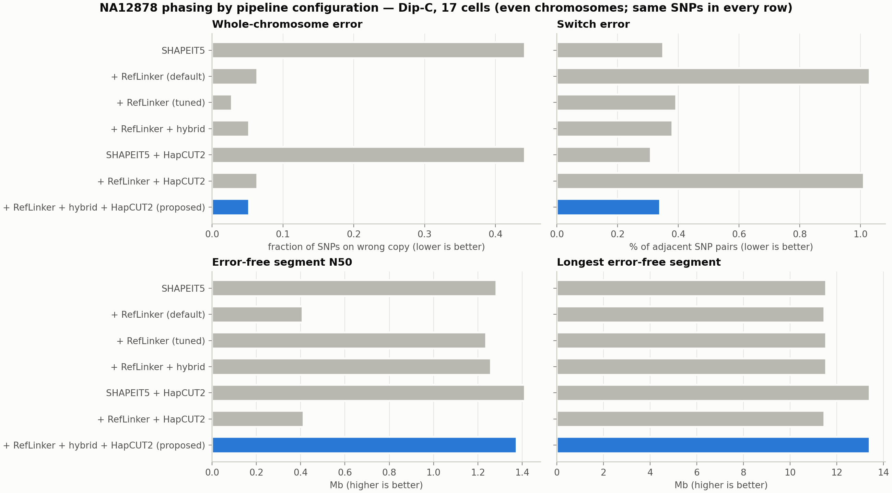
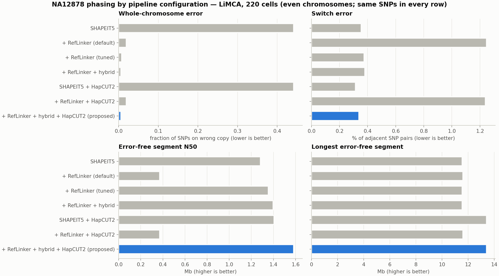

# Phaser verification on NA12878: SHAPEIT5 → RefLinker with single-cell Hi-C
*Status report, 2026-10-23 (added: SNPs without Hi-C link kept via nearest anchor, 4.3; confidence scores, 4.4)*

**In short.** We phase NA12878's het SNPs the way we plan to phase the brain donors, and score the result against her pedigree-phased truth.
- SHAPEIT5 gets the local phase right but not the chromosome-scale phase.
- RefLinker (single-cell Hi-C) fixes the chromosome-scale phase but adds small local errors.
- A simple **hybrid** step keeps the best of both.
- HapCUT2 (WGS reads) adds a small further gain.

Proposed pipeline: **SHAPEIT5 → RefLinker (default) → hybrid → HapCUT2**.

## 1. Key findings
1. **SHAPEIT5 alone is locally accurate but has no chromosome-scale phase.** It has 0.4% switch error, yet ~45% of het SNPs sit on the wrong haplotype across whole chromosomes.
2. **RefLinker (Hi-C) restores chromosome-scale phase** in both independent datasets¹. Wrong-haplotype SNPs drop to 7.0% (Dip-C, 17 cells) and 2.1% (LiMCA, 220 cells), improving steadily with cell number.
3. **RefLinker leaves many tiny wrong-haplotype islands** (median 2 SNPs), which triple the switch error. Two fixes remove them and also improve whole-chromosome accuracy:
   - a **hybrid** post-processing step (keep SHAPEIT5's local phase, take block orientation from RefLinker), which reaches **0.6%** wrong-haplotype SNPs at 220 cells;
   - a **stricter RefLinker flip threshold**.
4. **Removing duplicate and low-quality Hi-C reads does not help.** The islands come from RefLinker's decisions, not from read noise.
5. **Without HapCUT2, error-free segments are no longer than SHAPEIT5's** (longest ~11.5 Mb, N50 ~1.3 Mb).
   - The breaks that remain are SHAPEIT5's own errors, which Hi-C cannot fix.
   - These breaks (non-flip switches) stay at ~0.1% of SNP pairs in every configuration except default RefLinker.
6. **Read-based patching (HapCUT2, NA12878 WGS ~50×)** adds a small gain:
   - **On its own:** HapCUT2 phases 69.2% of het SNPs, in small blocks (block-span N50 0.6 kb; switch error within blocks 0.12%).
   - **Added to the hybrid (even chromosomes):**
     - error-free N50 1.26 → 1.38 Mb (Dip-C) and 1.40 → 1.58 Mb (LiMCA 220);
     - longest error-free segment 11.55 → 13.41 Mb in both;
     - Hamming 0.0522 → 0.0521 (Dip-C) and 0.0058 → 0.0056 (LiMCA 220).
7. **SNPs without a Hi-C link can be kept** (4.3). Orienting them like their nearest Hi-C-anchored SNP raises coverage
   from ~95% to 96.1% of truth hets, at a negligible cost: added SNPs have Hamming 0.04–0.08 instead of 0.41.
8. **Confidence scores help a little; pruning helps more** (4.4).
   - RefLinker's switch energy and HapCUT2's SNP quality lift N50 by 2–3% without dropping SNPs.
   - Leaving the least-supported SNPs unphased (switchE < 2) gives N50 2.3–2.6 Mb and longest error-free segments of
     24–26 Mb, keeping 76% (Dip-C) / 89% (LiMCA 220) of SNPs.

## 2. How the results are scored
All metrics compare a phasing with the truth, allowing one global swap of the two haplotypes. Only het SNPs present in both the phasing and the truth are scored. Each chromosome counts as one block.

| Metric | What it counts | Scale |
|---|---|---|
| **Hamming error** | SNPs on the wrong haplotype ÷ SNPs scored (0.5 = random) | whole chromosome |
| **Switch error** | switches ÷ adjacent SNP pairs scored. A switch is a pair of neighbouring SNPs whose relative phase is wrong. A single wrongly phased SNP (a *flip*) counts as 2 switches | local |
| **Flip error** | single wrongly phased SNPs ÷ adjacent SNP pairs (WhatsHap's "switch/flip decomposition") | local |
| **Non-flip switch error** | (switches − 2 × flips) ÷ adjacent SNP pairs. These are real block breaks: after one, a whole stretch is on the wrong haplotype (more severe) | local |
| **Longest error-free segment**, **error-free N50** | length (Mb) of the stretches between any two errors (flips included) | — |

- **Same SNPs:** within each table row group, every configuration is scored on the same SNPs (those RefLinker phased), so the rows are directly comparable.
- **Independent check:** `whatshap compare` (WhatsHap 2.8) reproduces every switch, flip, non-flip switch and Hamming rate in both results tables on the same SNPs (all 20 rows; differences ≤ 0.00001, from rounding only).
- **Fair testing:** the settings of the hybrid (window) and of tuning (threshold) are chosen on odd chromosomes. Results are reported on even chromosomes.

## 3. Pipeline and data
| Step | Tool | Input | Output |
|---|---|---|---|
| 1. Statistical phasing | SHAPEIT5 5.1.1 | unphased genotypes, reference panel, genetic map | complete phasing, one chromosome-long haplotype pair |
| 2. Hi-C read processing | `pre-meta` → `bwa mem -5SP` | raw single-cell Hi-C reads | merged BAM per dataset |
| 3. Hi-C refinement | RefLinker (`extract`, `pop`) | step-1 phasing + BAM | re-oriented phasing of Hi-C-linked SNPs |
| 4. Hybrid | our script | steps 1 + 3 | SHAPEIT5 phase with RefLinker's block orientation (majority vote over a window of SNPs) |
| 5. Read-based patching | HapCUT2 1.3.4 | WGS reads + genotypes | small read-backed blocks merged into step 4 |

- **Truth:** NA12878 pedigree-phased het SNPs (Platinum Genomes 2016-1.0, hg19).
  - 2,083,940 SNPs on chr1–22 and 63,598 on chrX.
  - Independent of any statistical or Hi-C phasing.
- **SHAPEIT5 input:** the truth het sites with the phase removed (plus hom-alt SNPs), mimicking a WGS genotype call set like the brain donors'.
  - Panel: 1000G phase3 without NA12878 and her relatives (2,501 samples; chrX: 1,269 women).
  - Genetic maps: b37.
- **Hi-C reads:** raw reads only, aligned by us to hg19. Two independent datasets¹:
  - Dip-C (Tan et al. 2018): 17 cells, 854 M read pairs.
  - LiMCA (Wu et al. 2024): 220 cells, 4,200 M read pairs, also run as nested subsets of 17, 50 and 100 cells.
- **WGS reads for HapCUT2:** NA12878 Platinum Genomes WGS (~50×). The brain donors' raw WGS reads are also available (Salk server).

## 4. Results

### 4.1 Hi-C restores chromosome-scale phase (SHAPEIT5 → RefLinker, default settings, chr1–22)
On the same SNPs, SHAPEIT5 alone has Hamming 0.446–0.447, switch error 0.38%, flip error 0.13–0.14% and non-flip switch error 0.11%.

| Hi-C data | het SNPs phased by RefLinker | Hamming | switch error | flip error | non-flip switch error | error-free N50 |
|---|---|---|---|---|---|---|
| Dip-C, 17 cells | 95.1% | 0.070 | 1.06% | 0.14% | 0.78% | 0.41 Mb |
| LiMCA, 17 / 50 / 100 / 220 cells | 87.4 / 94.5 / 94.9 / 95.2% | 0.217 / 0.057 / 0.035 / 0.021 | 0.87–1.29% | 0.13–0.28% | 0.61–0.83% | 0.36–0.53 Mb |

- Hamming falls steeply with more cells. Switch error rises about threefold because of RefLinker's tiny islands (fixed in 4.2).
- chrX shows the same pattern (Hamming 0.46 → 0.07 with Dip-C; 0.05 → 0.03 with 100–220 LiMCA cells). The exception is 17 LiMCA cells, which were too few on chrX (no gain).

*Fig. 1. LiMCA: share of het SNPs phased, Hamming error, longest error-free segment and error-free N50 vs number of cells. Blue: + RefLinker. Orange: SHAPEIT5 alone, scored on the same SNPs. The SHAPEIT5 phasing itself is identical at every cell count; its orange values move only because the set of scored SNPs (those RefLinker phased) grows with cell number.*

### 4.2 Fixing RefLinker's islands, and adding HapCUT2 (even chromosomes, same SNPs in every row)
Each cell gives Hamming / switch / flip / non-flip switch / error-free N50 / longest error-free segment.

| Configuration | Dip-C, 17 cells | LiMCA, 220 cells |
|---|---|---|
| SHAPEIT5 alone | 0.442 / 0.35% / 0.13% / 0.10% / 1.28 / 11.5 Mb | 0.442 / 0.35% / 0.13% / 0.10% / 1.28 / 11.5 Mb |
| + RefLinker (default) | 0.064 / 1.03% / 0.13% / 0.76% / 0.41 / 11.5 Mb | 0.019 / 1.25% / 0.27% / 0.70% / 0.37 / 11.6 Mb |
| + RefLinker (tuned threshold²) | **0.028** / 0.39% / 0.13% / 0.14% / 1.24 / 11.5 Mb | 0.0075 / 0.37% / 0.14% / 0.10% / 1.35 / 11.5 Mb |
| + RefLinker + hybrid³ | 0.052 / 0.38% / 0.13% / 0.13% / 1.26 / 11.5 Mb | 0.0058 / 0.38% / 0.14% / 0.11% / 1.40 / 11.5 Mb |
| + RefLinker + hybrid + HapCUT2 | 0.052 / **0.34%** / **0.10%** / 0.14% / **1.38** / **13.4** Mb | **0.0056** / **0.34%** / **0.11%** / 0.11% / **1.58** / **13.4** Mb |

² Flip threshold `-e` −50 (Dip-C) and −100 (LiMCA 220), instead of the README default −10.
³ Window of 1,001 (Dip-C) and 101 (LiMCA 220) SNPs. Any window from 3 to 201 SNPs improves on default RefLinker in every dataset.

**Reading the table, step by step:**
- **RefLinker (default):** Hamming drops sharply. Its extra errors are mostly short wrong stretches of ≥2 SNPs, so they show up as non-flip switches (0.70–0.76%) and the N50 shrinks.
- **Hybrid or tuned threshold:** both remove those stretches, bringing switch error back to SHAPEIT5's level and lowering Hamming further.
- **HapCUT2:** lowers the flip rate (0.13–0.14% → 0.10–0.11%), which accounts for its switch-error gain. It also lengthens error-free segments.
- **Why segments stop growing:** apart from default RefLinker, non-flip switches (real block breaks) stay at ~0.1%.
  - RefLinker re-orients the long blocks between SHAPEIT5's breaks, which is what drops Hamming, but it rarely removes the breaks themselves.
  - The hybrid keeps 741 of SHAPEIT5's 995 non-flip switches (LiMCA 220, even chromosomes) and adds new ones a median of 5 SNPs (~21 kb) away.
  - Long-range errors thus become short misphased stretches.
- **Cleaner reads give no gain:**
  - About 53–54% of Hi-C alignments were duplicates; only ~37% of alignments remain after deduplication and MAPQ ≥ 20.
  - Re-running RefLinker on them leaves Hamming essentially unchanged (Dip-C 0.064 → 0.065; LiMCA 220 0.019 → 0.019).

*Fig. 2. The four metrics for every configuration (even chromosomes, same SNPs per row), Dip-C (top) and LiMCA 220 cells (bottom). Blue: proposed pipeline SHAPEIT5 → RefLinker → hybrid → HapCUT2. Also shown: HapCUT2 merged onto SHAPEIT5 alone and onto default RefLinker.*

### 4.3 Keeping the SNPs that RefLinker did not link (nearest-linked-SNP orientation)
**What it does:**
- Until now, the output contained only RefLinker's scaffold SNPs. The ~1% of SHAPEIT5 SNPs without a usable Hi-C link
  were dropped.
- The extension keeps them. Each one keeps SHAPEIT5's phase, but is flipped if the hybrid flipped the nearest scaffold SNP
  (ties go to the right-hand neighbour). So its local phase comes from SHAPEIT5 and its orientation from its nearest Hi-C
  anchor. HapCUT2 blocks are then merged as before.
- We used it in the brain pilot; this is its test against the truth (even chromosomes).

| Dataset | SNP set | truth hets phased (chr1–22) | Hamming | switch / flip / non-flip | N50 | longest |
|---|---|---|---|---|---|---|
| Dip-C 17 | scaffold only (pipeline so far) | 95.05% | 0.0521 | 0.34 / 0.10 / 0.14% | 1.38 Mb | 13.4 Mb |
| Dip-C 17 | all SNPs (extension) | **96.06%** | 0.0523 | 0.35 / 0.11 / 0.14% | 1.35 Mb | 13.4 Mb |
| LiMCA 220 | scaffold only (pipeline so far) | 95.18% | 0.0056 | 0.34 / 0.11 / 0.11% | 1.58 Mb | 13.4 Mb |
| LiMCA 220 | all SNPs (extension) | **96.06%** | 0.0059 | 0.35 / 0.12 / 0.12% | 1.56 Mb | 13.4 Mb |

- **On the added SNPs alone** (10,682 Dip-C / 9,303 LiMCA on even chromosomes), Hamming falls from 0.42 / 0.41
  (SHAPEIT5 as is) to 0.077 / 0.035. So the nearest-anchor orientation works.
- The added SNPs are less accurate than scaffold SNPs, so overall accuracy dips very slightly.
- **Verdict:** +1% coverage (all SHAPEIT5 SNPs) for a negligible cost. It is kept in the brain pipeline.

### 4.4 Using confidence scores (RefLinker energy, HapCUT2 quality)
**Scores:**
- **RefLinker `switchE`:** a per-SNP energy for "a haplotype switch here". Low or negative means weak Hi-C support.
  - On odd chromosomes, SNPs with switchE < 0 are on the wrong haplotype 16–18% of the time, vs 2.0% (LiMCA 220) /
    7.5% (Dip-C) for switchE > 0.
  - The other RefLinker score, `deltaE`, is always 0 in `pop` output, so it is not usable.
- **HapCUT2:** per-SNP phred quality (0–100).

**How the refinement works (no SNP removed):**
- (R1) In the hybrid's window vote, only RefLinker SNPs with switchE ≥ t vote. Every scaffold SNP is then oriented by
  the nearest trusted vote.
- (R2) Only HapCUT2 SNPs with quality ≥ Q are merged.
- t and Q are chosen on odd chromosomes (lowest switch error with Hamming no worse than the pipeline) and tested on even
  chromosomes:
  - Dip-C: no switchE filter, Q ≥ 30.
  - LiMCA 220: switchE ≥ 0, Q ≥ 30.

**Pruning (SNPs removed):** after refinement, SNPs with switchE < p are left unphased, unless HapCUT2 phased them with
quality ≥ 30. Metrics are on the SNPs kept.

| Dataset | Configuration | SNPs kept | Hamming | switch / flip / non-flip | N50 | longest |
|---|---|---|---|---|---|---|
| Dip-C 17 | pipeline (4.2) | 100% | 0.0521 | 0.340 / 0.102 / 0.136% | 1.38 Mb | 13.4 Mb |
| Dip-C 17 | + confidence refinement | 100% | 0.0520 | 0.337 / 0.101 / 0.135% | 1.42 Mb | 13.4 Mb |
| Dip-C 17 | + pruning switchE < 0 | 99.1% | 0.0518 | 0.323 / 0.094 / 0.136% | 1.48 Mb | 13.4 Mb |
| Dip-C 17 | + pruning switchE < 2 | 76.3% | 0.0511 | 0.264 / 0.051 / 0.162% | 2.29 Mb | 23.6 Mb |
| Dip-C 17 | + pruning switchE < 6 | 71.5% | 0.0510 | 0.257 / 0.043 / 0.170% | 2.66 Mb | 23.6 Mb |
| LiMCA 220 | pipeline (4.2) | 100% | 0.0056 | 0.337 / 0.113 / 0.112% | 1.58 Mb | 13.4 Mb |
| LiMCA 220 | + confidence refinement | 100% | 0.0056 | 0.331 / 0.110 / 0.111% | 1.62 Mb | 13.4 Mb |
| LiMCA 220 | + pruning switchE < 0 | 98.8% | 0.0052 | 0.292 / 0.092 / 0.107% | 1.78 Mb | 13.8 Mb |
| LiMCA 220 | + pruning switchE < 2 | 89.4% | 0.0044 | 0.240 / 0.067 / 0.106% | 2.57 Mb | 25.6 Mb |
| LiMCA 220 | + pruning switchE < 6 | 81.3% | 0.0041 | 0.225 / 0.061 / 0.104% | 3.07 Mb | 25.6 Mb |

- **Refinement alone gives small gains:** N50 +2–3% (1.38 → 1.42; 1.58 → 1.62 Mb), switch error −1 to −2%.
- **Pruning trades coverage for accuracy:**
  - Dropping the ~1% of SNPs with switchE < 0 lifts N50 by 7–12% vs the pipeline.
  - Dropping more (switchE < 2) roughly doubles the longest error-free segment (13.4 → 24–26 Mb) and raises N50 to
    2.3–2.6 Mb, at a cost of 11% (LiMCA 220) to 24% (Dip-C) of SNPs.
  - It mostly removes flips. Real block breaks (non-flip) barely change, and rise slightly for Dip-C, because each break
    is now spread over fewer SNP pairs.
- The pruning level is a choice to make with the users of the haplotypes (more SNPs vs longer error-free stretches).

## 5. Practical notes
- **RefLinker** needed three memory-safety patches to run on sparse single-cell Hi-C (hard-clipped reads; chromosomes with few linked SNPs). They are included in our build.
- **Transfer to brain data:**
  - **Hybrid over tuning:** tuned thresholds are data-specific (the best value grew from −20 to −100 with cell number), and there is no truth to tune on for the donors. The hybrid is more robust: a fixed window of ~100–200 SNPs worked everywhere.
  - **Bisulfite reads:** the donors' snm3C-seq Hi-C reads are bisulfite-converted. Before RefLinker they need bisulfite-aware alignment (e.g. Bismark), plus masking of conversion-ambiguous bases using the donors' WGS het SNPs.
- **SNPs not phased:** 3.9% of truth het SNPs are absent from the panel, so SHAPEIT5 can't phase them. Of the rest, ~1% have no Hi-C link; they are now kept (4.3).
- **Cost:** ~4.2k core-hours so far. RefLinker needs up to ~52 GB of memory per large chromosome at 220 cells.

## 6. Next steps (for discussion)
1. Final pipeline: SHAPEIT5 → RefLinker (default) → hybrid → HapCUT2, keeping unlinked SNPs (4.3), with confidence
   refinement (4.4). The pruning level is still to be decided with the haplotype users.
2. Brain donors: the donor-1 pilot (100 snM3C-seq cells; bisulfite-aware reads and masking) is done, and is reported
   separately. Next: donors 2 and 3, and the donors' WGS reads for HapCUT2.

¹ *The two datasets differ in depth, read length, lab and cell clone, so they are independent reference points and are not compared with each other.*

*Code, logs and data: `/anvil/projects/x-bio260019/x-aahmed7/phaser-verification/` on Purdue Anvil.*
