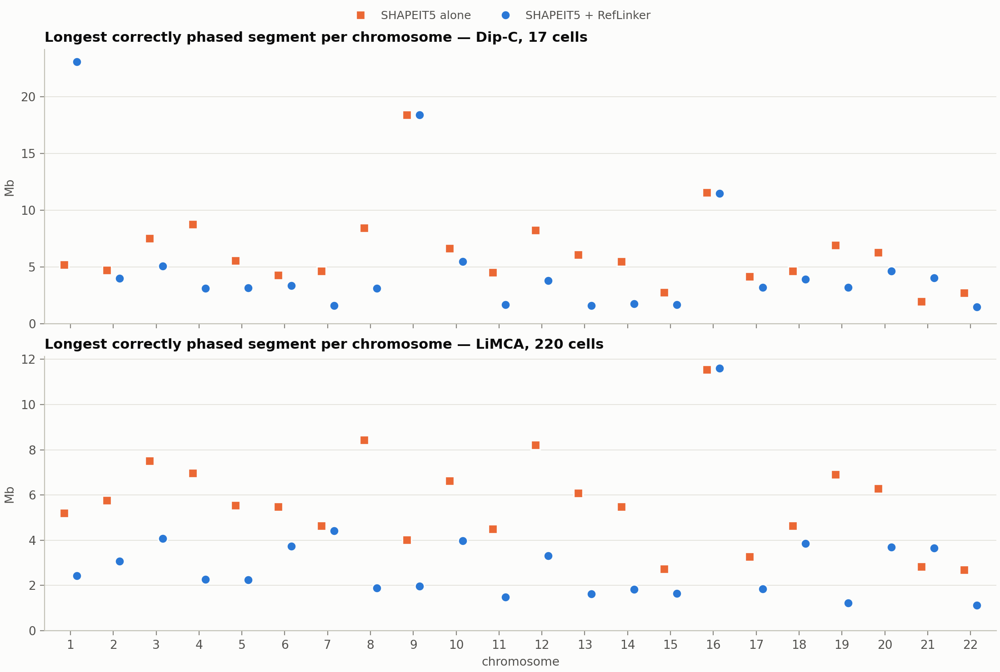

# Phaser verification on NA12878: SHAPEIT5 → RefLinker with single-cell Hi-C
*Status report, 2026-10-12*

## Key findings and conclusions
- **We can now evaluate phasing without circularity.** We score against NA12878's pedigree-phased truth (Platinum Genomes), not against another statistical phasing.
- **SHAPEIT5 alone is locally accurate but has no chromosome-scale phase.** Switch error is 0.40%, yet 44.7% of het SNPs end up on the wrong haplotype across whole chromosomes, close to the 50% of a random guess. Large blocks get flipped. *Conclusion:* statistical phasing alone can't give haplotype-resolved 3D structures.
- **Adding RefLinker (Hi-C) restores chromosome-scale phase in both independent datasets.** SNPs on the wrong haplotype drop from 44.7% to **7.0%** with Dip-C (17 cells) and to 21.7 → 5.7 → 3.5 → **2.1%** with LiMCA 17 → 50 → 100 → 220 cells. *Conclusion:* the pipeline works, and with more cells it gets better.
- **The remaining errors are tiny islands, not large blocks.** With 220 cells there are ~12.8k islands with a median of 2 SNPs (0.4 kb). Each island counts as two switches, so switch error *rises* (≈1.3%) and segment N50 *falls* (≈0.36 Mb), even though chromosome-scale phase is far better. *Conclusion:* report Hamming error together with segment metrics; segment metrics alone are misleading. "Longest correct segment" is especially fragile.
- **chrX follows the same pattern** (Hamming 0.45 → 0.03 with 220 LiMCA cells; 0.45 → 0.07 with Dip-C), except that 17 LiMCA cells weren't enough on chrX.
- **Room for improvement:** removing the tiny islands (next steps) may combine SHAPEIT5's local accuracy with RefLinker's global accuracy.

## Design

### Pipeline
| Step | Tool | Input | Output |
|---|---|---|---|
| 1. Statistical phasing | SHAPEIT5 5.1.1 `phase_common`, per chromosome | NA12878 unphased genotypes, reference panel, genetic map | phased VCF: every het SNP as `0\|1`/`1\|0`, one chromosome-long haplotype pair (no blocks) |
| 2. Hi-C read processing | `pre-meta` → `bwa mem -5SP` → samtools | raw single-cell Hi-C FASTQ | one coordinate-sorted BAM per run, merged per dataset |
| 3. Hi-C link extraction | RefLinker `extract -e hic` | SHAPEIT5 VCF (seed) + merged BAM | read-to-SNP link graph (pairs of het alleles seen on the same molecule) |
| 4. Haplotype refinement | RefLinker `pop` (README settings `-e -10 -w 2000 -p 0.999`) | seed VCF + link graph | per-SNP haplotype assignment for linked SNPs; converted to VCF by us |
| 5. Evaluation | our scorer | phased VCF + truth | metrics below |

### Data
- **Ground truth:** NA12878, Illumina Platinum Genomes 2016-1.0, phased from the CEPH-1463 pedigree (independent of any Hi-C or statistical phasing). 2,083,940 het SNPs on chr1–22 and 63,598 on chrX non-PAR (none in the PARs). hg19 (hs37d5).
- **SHAPEIT5 input:** the truth het sites with phase removed, plus NA12878's hom-alt SNPs from 1000G phase3. This mimics a WGS genotype call set like the brain donors'.
- **Reference panel:** 1000G phase3 (hg19), biallelic SNPs, minus NA12878 and her relatives present (paternal grandparents NA12889/NA12890; parents aren't in phase3): 2,501 samples. **chrX:** the 1,269 women only (men are haploid on X), non-PAR region.
- **Genetic maps:** b37 maps from the SHAPEIT4 distribution (chr1–22, chrX).
- **Hi-C reads** (raw reads only; processed contact files carry haplotype labels derived from known phasing):

  | Dataset | Cells | Read pairs | Reads | Source |
  |---|---|---|---|---|
  | Dip-C (Tan et al. 2018) | 17 (25 runs) | 854 M | 2×250 bp | SRA SRP149125 |
  | LiMCA (Wu et al. 2024, *Nat Methods*) | 220 | 4,200 M | 2×150 bp | SRA PRJNA1002315 |

  The two datasets are analysed independently, each as its own reference point; we don't compare them.¹ LiMCA is also analysed as nested random subsets (17 ⊂ 50 ⊂ 100 ⊂ 220 cells) to see how accuracy depends on cell number. One deposited LiMCA cell with 38k read pairs was excluded (presumably the cell the paper excluded). LiMCA base qualities come from NCBI's SRA-Normalized files, because ENA serves these runs quality-stripped.

### Metrics
Per chromosome, on the het SNPs each method phases (for RefLinker: the SNPs linked by Hi-C), compared with the truth up to a global haplotype swap:
- **Switch error:** fraction of adjacent SNP pairs whose relative phase is wrong (local accuracy). Also reported excluding single-SNP flips.
- **Hamming error:** fraction of SNPs on the wrong haplotype under the best global orientation (chromosome-scale accuracy; 0.5 ≈ random).
- **Longest error-free segment** and **error-free segment N50** (Mb).
- **Linked SNPs:** % of truth het SNPs that RefLinker phases.

## Results

### chr1–22
SHAPEIT5 alone on all phased SNPs: 2,001,904 het SNPs (96.1% of truth; the rest aren't in the panel or differ in alleles), Hamming 0.447, switch error 0.40% (0.11% excl. flips), segment N50 1.21 Mb, longest correct 21.4 Mb.
Below, both methods are scored on the same SNPs: those RefLinker phases in each dataset.

**Dip-C (17 cells)**

| Phasing | het SNPs | Hamming | switch error (excl. flips) | segment N50 | longest correct |
|---|---|---|---|---|---|
| SHAPEIT5 alone | 1,980,807 | 0.447 | 0.38% (0.11%) | 1.25 Mb | 18.4 Mb |
| + RefLinker | 1,980,807 | **0.070** | 1.06% (0.78%) | 0.41 Mb | 23.1 Mb |

**LiMCA (nested subsets)**

| Phasing | cells | het SNPs | Hamming | switch error (excl. flips) | segment N50 | longest correct |
|---|---|---|---|---|---|---|
| SHAPEIT5 alone | – | 1.82–1.98 M | 0.446–0.447 | 0.38% (0.11%) | 1.24–1.34 Mb | 11.5–22.5 Mb |
| + RefLinker | 17 | 1,822,162 | **0.217** | 0.87% (0.61%) | 0.53 Mb | 21.5 Mb |
| + RefLinker | 50 | 1,968,633 | **0.057** | 1.11% (0.79%) | 0.41 Mb | 21.5 Mb |
| + RefLinker | 100 | 1,978,007 | **0.035** | 1.25% (0.83%) | 0.37 Mb | 21.5 Mb |
| + RefLinker | 220 | 1,983,556 | **0.021** | 1.29% (0.74%) | 0.36 Mb | 11.6 Mb |

*Fig. 1. LiMCA: % of truth het SNPs phased by RefLinker, Hamming error, longest error-free segment and segment N50 vs number of cells. Blue: SHAPEIT5 + RefLinker; orange: SHAPEIT5 alone on the same SNPs.*

**Where the remaining errors are.** An "island" is a run of consecutive SNPs on the wrong haplotype.

| Dataset | Phasing | SNPs on wrong haplotype | islands | median island | wrong SNPs in islands ≥1 Mb | RefLinker changes to seed: right / wrong |
|---|---|---|---|---|---|---|
| Dip-C 17 | SHAPEIT5 alone | 44.7% | 3.7k | 10 SNPs / 21 kb (tail to Mb blocks) | 55% | |
| Dip-C 17 | + RefLinker | 7.0% | 10.5k | 6 SNPs / 5.6 kb | 0.5% | 817k / 70k |
| LiMCA 220 | SHAPEIT5 alone | 44.7% | 3.8k | 10 SNPs / 23 kb (tail to Mb blocks) | 54% | |
| LiMCA 220 | + RefLinker | 2.1% | 12.8k | 2 SNPs / 0.4 kb | 0.03% | 886k / 21k |

*Fig. 2. Longest error-free segment per chromosome, Dip-C (top) and LiMCA 220 cells (bottom). A single wrong SNP splits a segment, so this metric understates RefLinker's chromosome-scale gain.*

### chrX (non-PAR)
SHAPEIT5 alone: 61,395 het SNPs (96.5%), Hamming 0.456, switch error 0.45%.

| Dataset | cells | het SNPs | Hamming: SHAPEIT5 alone → + RefLinker | switch error: + RefLinker |
|---|---|---|---|---|
| Dip-C | 17 | 60,128 | 0.451 → **0.073** | 0.87% |
| LiMCA | 17 | 52,887 | 0.444 → **0.475** (no gain) | 0.72% |
| LiMCA | 50 | 59,048 | 0.447 → **0.072** | 0.87% |
| LiMCA | 100 | 59,642 | 0.449 → **0.049** | 1.05% |
| LiMCA | 220 | 60,001 | 0.450 → **0.027** | 1.18% |

## Technical notes
- **RefLinker patches (needed to run at all).** Three memory-safety bugs crashed RefLinker on our data. All are fixed in our build, with minimal changes:
  1. hard-clipped supplementary alignments, typical of chimeric Hi-C reads, overflowed a buffer in `extract`;
  2. and 3. chromosomes with fewer linked SNPs than `pop`'s search windows overflowed or dereferenced empty arrays. This happens with sparse single-cell Hi-C (presumably rarely with deep bulk Hi-C).

  We also note that `pop` writes 0-based positions.
- **Suggestion (1), hybrid phasing.** SHAPEIT5 is very accurate locally and RefLinker globally. Keep SHAPEIT5's phase within blocks and take only each block's orientation from RefLinker (e.g. a windowed majority vote over RefLinker's flip decisions). This needs no truth, and it's cheap because it uses existing outputs.
- **Suggestion (2), cleaner Hi-C input.** In Hi-C mode, RefLinker doesn't filter reads: amplification duplicates and low-mapping-quality reads count as links. Re-running on deduplicated, MAPQ-filtered BAMs tests whether read noise causes the islands.

## Notes and limitations
- **Bisulfite Hi-C reads (for the brain data).** The donors' WGS het genotypes go into SHAPEIT5 unchanged. But the snm3C-seq reads given to RefLinker are bisulfite-converted: unmethylated C reads as T. At C/T (and G/A) SNPs, RefLinker can't tell which allele a read carries, so those contacts need bisulfite-aware alignment and allele calling, or must be excluded.
- **SNPs not phased by RefLinker.** 3.9% of truth het SNPs are absent from the 1000G panel (or differ in alleles), so SHAPEIT5 can't phase them. Of the rest, ~1% have no Hi-C link (1.1% Dip-C, 0.9% LiMCA 220; 9.0% LiMCA 17). These keep SHAPEIT5's phase and are excluded from the RefLinker metrics.
- **RefLinker parameters:** `pop` was run with the settings recommended in its README for bulk Hi-C, not tuned here: flip-evidence threshold `-e -10`; large-window limit `-w 2000` (blocks of 1–2,000 SNPs are always tried, so single-SNP flips are possible); hub-SNP pruning `-p 0.999`. One random cell draw per LiMCA subset size.
- **Cost and scaling:** ~2.5k core-hours in total. RefLinker's memory and time grow with read depth (~52 GB and ~2 h for the largest chromosomes at 220 cells), which matters at brain scale.

¹ *The datasets also differ in sequencing depth (854 M vs 4,200 M read pairs in total; per cell ~50 M vs ~19 M), read length (2×250 vs 2×150 bp), lab, and GM12878 clone (LiMCA's cells were grown from a single-cell clone).*

## Next steps
1. Suggestion (1), hybrid phasing, on all datasets.
2. Suggestion (2), filtered BAMs, on all datasets.
3. (1) + (2) combined, then pick the best pipeline.
4. Apply it to the Science-2023 brain donors: WGS genotypes → SHAPEIT5 (hg38 reference, panel and maps), then RefLinker with bisulfite-aware allele calling on the snm3C-seq reads.

*Code, logs and data: `/anvil/projects/x-bio260019/x-aahmed7/phaser-verification/` (scripts/, logs/LOG.md, results/).*
