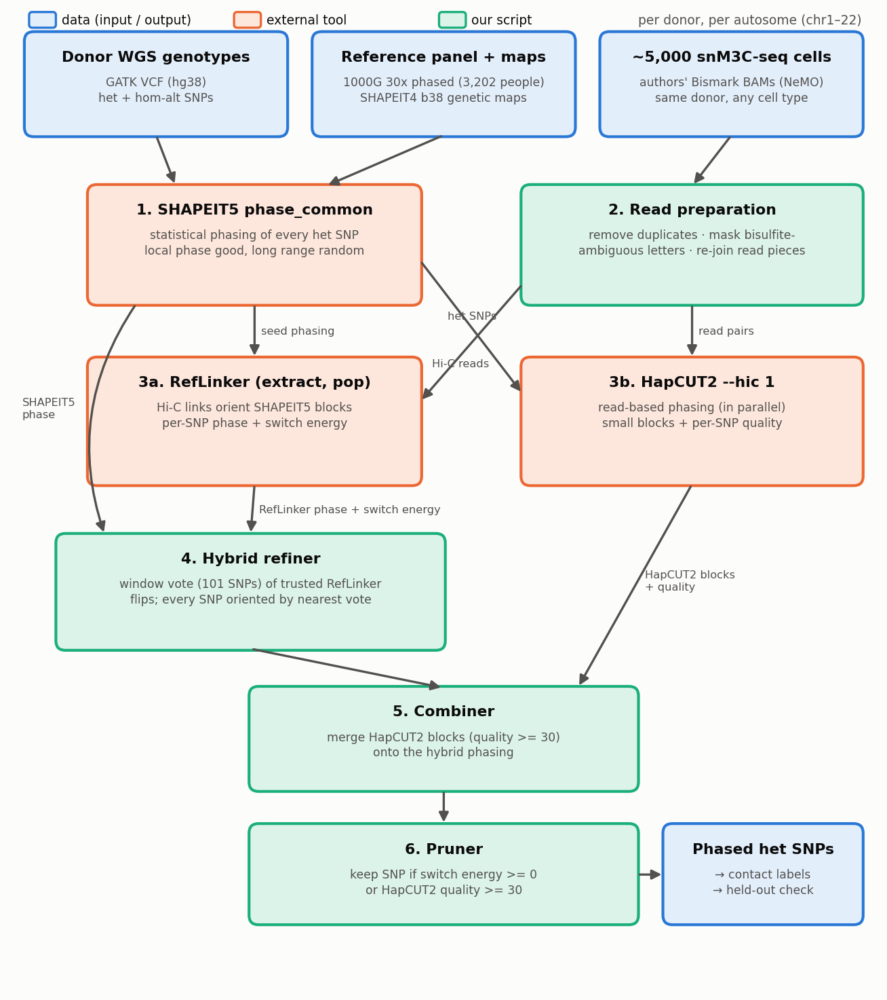

# Phaser pipeline guide: phasing a brain donor's het SNPs with WGS + snM3C-seq
*Version 2026-11-10. Pipeline as used for the human brain donors (H1930001, H1930002, H1930004).*

**Goal.** For one donor, decide for every heterozygous (het) SNP which letter sits on chromosome copy A and which on
copy B ("phasing"), consistently along each whole chromosome. The phased SNPs are then used to label Hi-C contacts
with the copy they came from.

**Idea in one paragraph.**
1. **SHAPEIT5** guesses the phase from a population reference panel. This is accurate over short stretches, but the
   orientation of distant stretches is random.
2. **RefLinker** uses Hi-C reads from the donor's own cells (contacts link SNPs far apart on the same copy) to flip
   whole stretches the right way round.
3. **The hybrid refiner** keeps SHAPEIT5's short-range phase and takes only the stretch orientation from RefLinker,
   by a window majority vote. This removes RefLinker's tiny wrong islands.
4. **HapCUT2**, run in parallel on the same reads, fixes some single SNPs inside short read-backed blocks.
5. **Pruning** finally leaves unphased the SNPs that no tool supports confidently.


*Blue = data, orange = external tool, green = our script. Everything runs per donor and per autosome (chr1–22).*

**Software:** SHAPEIT5 5.1.1 · RefLinker (commit 1e55de8, plus our three memory-safety patches) · HapCUT2 1.3.4 ·
bcftools / samtools 1.21 · Python 3.11 + pysam 0.22.
Code: `/anvil/projects/x-bio260019/x-aahmed7/human-brain-phasing/scripts/`; the driver is `bash/run_donor_v2.sh`.

---

## Step 0. Inputs
| Input | What it is | Where |
|---|---|---|
| WGS genotypes | GATK VCF of the donor (hg38) | `donor_genomes/h19300XX/H19300XX.final.vcf.gz` |
| Reference panel | 1000 Genomes 30x phased panel, 3,202 people (hg38) | EBI `1000G_2504_high_coverage/working/20220422_3202_phased_SNV_INDEL_SV` |
| Genetic maps | SHAPEIT4 b38 maps (recombination rates) | `odelaneau/shapeit4` `maps/genetic_maps.b38.tar.gz` |
| snM3C-seq reads | authors' per-cell BAMs (Bismark `--pbat`, hg38), ~5,000 random cells of the donor | NeMO `m3C-seq/human/processed/align/<cell>.3C.sorted.bam.tar` |

**Target genotypes** (`bash/02b_prep_target_donor.sh`): keep good-quality SNPs with exactly two letters, on chr1–22:
```
bcftools view -r chrN -f PASS -m2 -M2 -v snps -i 'GT="het" || GT="AA"' donor.vcf.gz \
 | bcftools annotate -x INFO,^FORMAT/GT | bcftools reheader -s rename.txt -o target/chrN.bcf
```
Output: `data/target/chrN.bcf` (het + hom-alt SNPs) and `data/target/het_snps.tsv.gz` (the het SNP list), about
1.9 M het SNPs per donor.

## Step 1. SHAPEIT5: statistical phasing
**What it does:** compares the donor's genotypes with the 3,202 phased people in the panel and picks the most likely pair
of copies. It is good locally, but beyond ~1 Mb the orientation is a coin flip.

**Preparation** (`slurm/03_panel_shapeit5.sbatch`):
- Panel → biallelic SNPs, GT only, with the allele counts SHAPEIT5 needs:
  `bcftools view -m2 -M2 -v snps | bcftools annotate -x INFO,^FORMAT/GT | bcftools +fill-tags -- -t AC,AN`.
- Target → only sites that are in the panel with the same letters (sites missing from the panel can't be phased):
  `bcftools isec -c none -n=2 -w1 target.bcf panel.bcf | bcftools +fill-tags -- -t AC,AN`.

**Command:**
```
SHAPEIT5_phase_common --input target_in_panel_chrN.bcf --reference panel_chrN.bcf \
  --map chrN.b38.gmap.gz --region chrN --thread 4 --output shapeit5/chrN.bcf
```
Default model settings (15 MCMC iterations, PBWT and HMM windows of 4 cM).

**Output:** `data/shapeit5/chrN.bcf`, every het SNP phased (`0|1` or `1|0`). For donor 1: 1,890,745 of 1,927,881 het
SNPs (98.1%).

## Step 2. Read preparation (our script, `python/process_cell_bam.py`, one job per 50 cells)
The authors aligned each read end on its own, and cut ends that did not align into pieces (`-l`, `-m`, `-r`). So one DNA
fragment ("molecule") appears as 2–6 unconnected lines in the BAM. For each cell:
1. **Re-join:** group all pieces of a molecule by their shared read name.
2. **Remove duplicates:** molecules with exactly the same piece positions are kept once.
3. **Read the letter at each het SNP, with bisulfite masking.** Bisulfite turns unmethylated C into T. Bismark's tag
   `XG` says which DNA strand was converted:

   | Strand (`XG`) | Read letter at the SNP | SNP letters | Action |
   |---|---|---|---|
   | `CT` | T | C/T | **mask** (could be a real T or a converted C) |
   | `CT` | T | A/C | change to C (T must be a converted C) |
   | `CT` | C | C/T | keep (a C that stayed C is real) |
   | `GA` | A | G/A | **mask** |
   | `GA` | A | G/T | change to G |
   | any | ref or alt letter | other SNPs | keep |

4. **Keep only informative pieces** (pieces with at least one readable het SNP) and write them twice:
   - `rl.bam` for RefLinker: all pieces of a molecule share one read name, which is how RefLinker links them.
   - `hc.bam` for HapCUT2: the pieces of a molecule on one chromosome are chained into ordinary read pairs.

Then all cells are merged (`slurm/05b_merge_list.sbatch`) into `data/bam/<ID>.rl.bam` and `<ID>.hc.bam`.
For 2,370 cells: 251 M informative pieces.

## Step 3a. RefLinker: Hi-C orientation of SHAPEIT5 blocks
**What it does:** builds a graph of SNPs linked by the same molecule, then searches for the phase that best fits those
links. It starts from SHAPEIT5's phase and uses the population phase as a weak prior.

**Commands** (`slurm/06_reflinker.sbatch`, README default settings):
```
linker extract -v seed_chrN.vcf.gz -i ID.rl.bam -n ID -e hic -c chrN
linker pop -v seed_chrN.vcf.gz -g output/graph_variant_ID_hic_chrN.dat -c chrN -n ID -e -10.0 -w 2000 -p 0.999
```
- `seed_chrN.vcf.gz` = SHAPEIT5 output.
- `-e hic` = Hi-C read mode (MAPQ > 20, base quality ≥ 20).
- The contig order of the BAM and VCF headers must match; the job checks this.

**Output:** `output/pop_hap_solution_ID_chrN.dat`, one line per linked SNP:
`index, position (0-based), ref, alt, RefLinker hap, SHAPEIT5 hap, deltaE, switchE`.
- **switchE** ("switch energy") = how much worse the fit to the Hi-C links would get if the copies were swapped right
  after this SNP. High means strong Hi-C support; low or negative means weak or conflicting support. On NA12878, SNPs with
  switchE < 0 were on the wrong copy 16–18% of the time, vs 2.0–7.5% for the others.
- `deltaE` is always 0 in this mode and is not used.
- `python/apply_reflinker.py` turns this into `chrN.seed.bcf` (SHAPEIT5 phase) and `chrN.reflinker.bcf` (RefLinker phase)
  on the linked SNPs, called the **scaffold**. Donor 1 with 2,370 cells: 97.6% of SNPs.

## Step 3b. HapCUT2: read-based phasing (in parallel with 3a)
**What it does:** phases SNPs directly from reads that cover several SNPs. Blocks are short, but the phase inside them
is reliable.

**Commands** (`slurm/07_hapcut2.sbatch`):
```
extractHAIRS --hic 1 --bam ID.hc.bam --VCF chrN.het.vcf --region chrN --out chrN.frag
HAPCUT2 --hic 1 --fragments chrN.frag --VCF chrN.het.vcf --output chrN.hap --outvcf 1
```
- `chrN.het.vcf` = the SHAPEIT5 het SNPs with the phase removed (`0/1`).
- `--hic 1` = Hi-C mode (read pairs up to 40 Mb apart).

**Output:** `chrN.hap` (blocks; per SNP: copy-A letter, pruned flag, **quality** = column 11, a phred score 0–100) and
`chrN.hap.phased.VCF`.
- **Phred score:** Q = −10·log10(chance the phase is wrong). Q 30 means 1 in 1,000, i.e. 99.9% sure.
- Donor 1 with 2,370 cells: 1.59 M SNPs phased, 1.37 M with quality ≥ 30.

## Step 4. Hybrid refiner (our script, `python/combine_confidence.py`)
**Why:** RefLinker gets the orientation of long stretches right, but leaves tiny wrong "islands" (median 2 SNPs).
SHAPEIT5 is right locally. The hybrid takes the best of both.

**How it works** (per chromosome):
1. **Flip track:** for each scaffold SNP, d = 1 if RefLinker's phase differs from SHAPEIT5's, else 0.
2. **Trusted voters:** only scaffold SNPs with switchE ≥ 0 vote.
3. **Window vote:** for each voter, look at the W = 101 voters centred on it (50 on each side; fewer at chromosome ends).
   - More than half are 1 → vote "flip".
   - Fewer than half → vote "keep".
   - Exact tie → keep the SNP's own d.
4. **Apply to every SHAPEIT5 SNP**, including SNPs RefLinker did not link: take the vote of the nearest trusted voter
   (ties go to the right-hand one). Flip SHAPEIT5's phase if that vote says "flip".

**Toy example** (W = 5; one row of 16 scaffold SNPs; all trusted):
```
SNP            1 2 3 4 5 6 7 8 | 9 10 11 12 13 14 15 16
flip track d   0 0 0 1 0 0 0 0 | 1  1  1  0  1  1  1  1
window vote    0 0 0 0 0 0 0 0 | 1  1  1  1  1  1  1  1
```
- SNP 4 is a one-SNP RefLinker island: its window (2–6) holds one "1" out of five, so it is out-voted → kept as SHAPEIT5.
- SNP 12 is a gap inside a flipped stretch: its window (10–14) holds four "1"s → flipped with its block.
- Result: the left block keeps SHAPEIT5's phase; the right block is flipped as a whole.
- A SNP without a Hi-C link between SNPs 10 and 11 would follow its nearest voter → flipped too.

## Step 5. Combiner: merge HapCUT2 blocks (same script)
**Why:** fixes single wrongly phased SNPs inside HapCUT2's short blocks.

**How it works:**
1. Take HapCUT2 SNPs with quality ≥ 30 (and not pruned by HapCUT2 itself) whose letters match the hybrid's SNP.
2. Group them by HapCUT2 block. Skip blocks with fewer than 2 such SNPs.
3. A HapCUT2 block's own orientation is arbitrary, so align it to the hybrid: count the SNPs where the block agrees with
   the hybrid.
   - Majority agree → use the block as is.
   - Majority disagree → flip the whole block.
   - Exactly half → skip the block (no way to tell).
4. Overwrite the hybrid's phase at the block's SNPs with the aligned block phase.

**Toy example** (a 4-SNP HapCUT2 block; A = alt letter on copy A):
```
SNP              a   b   c   d
hybrid copy A    ref alt alt ref
HapCUT2 copy A   alt ref ref alt     -> disagrees at 4/4 -> flip block -> ref alt alt ref -> no change
```
```
SNP              a   b   c   d
hybrid copy A    ref alt ref ref
HapCUT2 copy A   alt ref ref alt     -> disagrees at 3/4 -> flip block -> ref alt alt ref -> SNP c corrected
```

## Step 6. Pruner (same script)
**Why:** some SNPs have no confident support from any tool. It is better to leave them unphased than to keep a guess.

**Rule:** keep a SNP only if
- it is a RefLinker scaffold SNP with **switchE ≥ 0**, or
- HapCUT2 phased it with **quality ≥ 30**.

Everything else is removed from the output (unphased). A pruned SNP does not cut an error-free stretch; stretches are
simply measured over the remaining SNPs.

**Toy example:**

| SNP | on scaffold? | switchE | HapCUT2 quality | kept? |
|---|---|---|---|---|
| 1 | yes | 12.0 | – | yes (Hi-C support) |
| 2 | yes | −3.5 | 45 | yes (HapCUT2 confident) |
| 3 | yes | −3.5 | 12 | **no** |
| 4 | no (no Hi-C link) | – | – | **no** |
| 5 | no | – | 100 | yes |

**Cut-off history:**
- switchE < 2 was used in the first runs. With sparse data (100 cells) it removed 61% of SNPs for no gain.
- **switchE < 0 is used from 2026-11-06.** switch energies grow with the amount of Hi-C data, so the cut-off should be
  re-checked when the depth changes.

**Outputs** (`data/final/<ID>/`):
- `chrN.final.bcf`: plain pipeline (no confidence scores, no pruning).
- `chrN.final_conf.bcf`: confidence-guided, all SNPs.
- **`chrN.final_pruned.bcf`: the deliverable phasing.**
- Summary: `results/phasing_confidence_<ID>.tsv`.

## Step 7. Using the phasing: labelling contacts (`python/phase_contacts.py`)
- Each contact end in a ChromoGen contact file is matched to the read piece it came from, in that cell's own BAM (all
  5.4 M tested contacts matched).
- If that piece, or another piece of the same molecule within 1 kb, covers a phased het SNP, the letter there gives the
  label: 0 = copy A, 1 = copy B. Conflicting letters or no SNP give −1 (unlabelled). The same bisulfite rules apply.
- Male donors: chrX ends get 1 (maternal) and chrY ends 0 (paternal), except in the pseudo-autosomal regions.
- Autosome labels are consistent along a chromosome only. Which parent each copy came from is unknown.
- About 7% of ends and 11–12% of contacts get a label. This is set by SNP density (~1 per 1.5 kb) and short reads, not
  by the phasing.

## Step 8. Checking the result without a truth set (`python/qc_cis_agreement.py`, `qc_authors_contacts.py`)
- Most contacts join two places on the **same** chromosome copy, so a correct phasing gives both ends the same label.
  Random orientation gives ~50% agreement.
- The check uses 20 held-out cells per donor, never used for phasing, and reports agreement by distance.
- Donor 1, authors' contacts:

| Phasing | 0.1–1 Mb | 1–10 Mb | > 10 Mb |
|---|---|---|---|
| SHAPEIT5 alone | 79.7% | 57.7% | 49.1% |
| pipeline, 2,370 cells | 95.5% | 94.5% | 87.2% |
| pipeline + pruning, 2,370 cells | 96.1% | 95.0% | 88.4% |

## Settings at a glance
| Step | Setting | Value |
|---|---|---|
| SHAPEIT5 | panel / maps | 1000G 30x (3,202), b38 maps, defaults |
| Read prep | duplicates / masking | identical molecules once; bisulfite rules above |
| RefLinker | `pop` | `-e -10.0 -w 2000 -p 0.999` (README defaults) |
| HapCUT2 | mode | `--hic 1` (extractHAIRS and HAPCUT2) |
| Hybrid | window / voters | W = 101 SNPs; voters with switchE ≥ 0 |
| Combiner | HapCUT2 SNPs used | quality ≥ 30; blocks with ≥ 2 SNPs; ties skipped |
| Pruner | keep if | switchE ≥ 0 or HapCUT2 quality ≥ 30 |
| Cells | per donor | ~5,000 random cells; ≥ 4,500 must be processed |

## Where this was tested
- **NA12878** (true phasing known from the family), with two independent single-cell Hi-C datasets: see
  [`NA12878-phaser-verification/phaser_verification_report.md`](../NA12878-phaser-verification/phaser_verification_report.md).
- On NA12878 (LiMCA 220 cells), the full pipeline gave **0.56% of SNPs on the wrong copy**, switch error 0.34%, and
  error-free N50 1.58 Mb (2.6 Mb with pruning at the earlier cut-off of switchE < 2).
